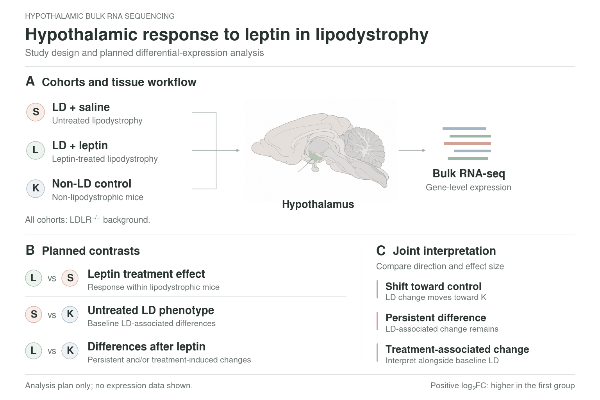
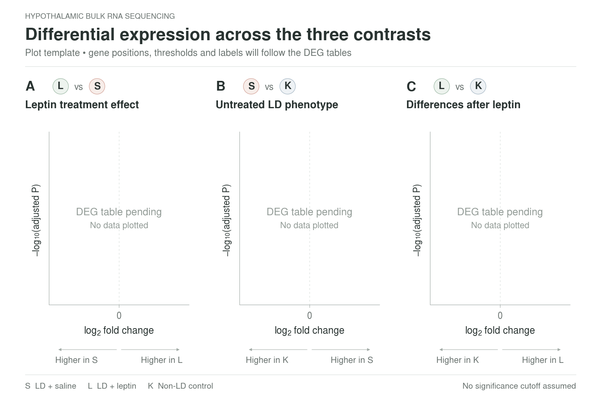

# LipoHypoLEP

Hypothalamic bulk RNA-seq figure templates for lipodystrophic mice, with saline-treated LD (S), leptin-treated LD (L), and non-LD LDLR−/− controls (K).

These figures show the study design and planned analysis. No expression data, DEG counts, or statistical results have been simulated.

## View and download the figures

Click an image to view it. On a GitHub file page, use the **Download raw file** button to save the original. The ZIP contains all exports, source, artwork, style notes, dependency versions, and the font audit.

**[Download the complete figure pack](figures/lipohypolep_figure_templates.zip)**

### Study design

[PNG](figures/01_study_design.png) · [PDF](figures/01_study_design.pdf) · [SVG](figures/01_study_design.svg) · [High-resolution PNG](figures/01_study_design_300dpi.png)

### Volcano-plot template

[PNG](figures/02_volcano_template.png) · [PDF](figures/02_volcano_template.pdf) · [SVG](figures/02_volcano_template.svg) · [High-resolution PNG](figures/02_volcano_template_300dpi.png)

## Style and source

Both figures use a white 3:2 canvas, muted coral/sage/blue-gray cohort colors, and large Nimbus Sans type. The PNGs are 1536 × 1024; high-resolution exports are 4608 × 3072. All lettering in the PDF/SVG files is outlined to prevent font substitution. The Python source retains editable labels.

See [style, scientific conventions, and regeneration instructions](figures/STYLE_AND_USAGE.md), [editable source](figures/make_figures.py), and [pinned Python dependencies](figures/requirements.txt).

The three contrasts are **L vs S**, **S vs K**, and **L vs K**. Positive log2 fold change means higher expression in the first named group. L vs K can contain persistent LD differences and treatment-associated changes; nonsignificance alone does not establish normalization.
