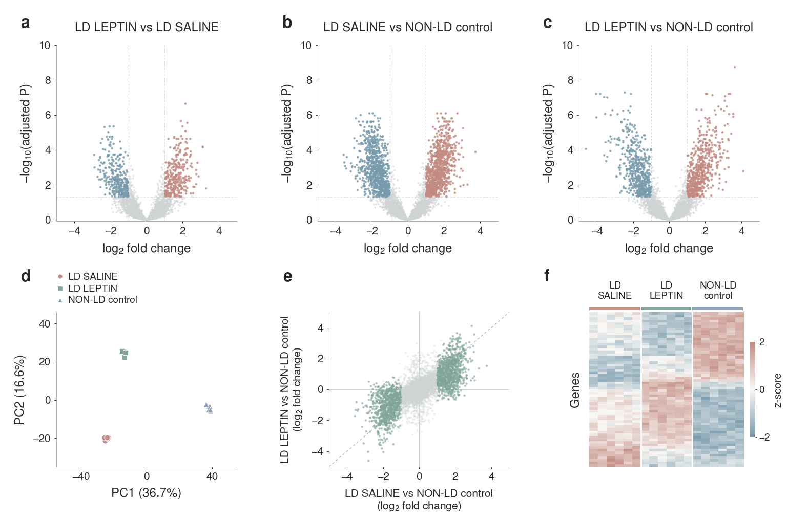

# LipoHypoLEP

Hypothalamic bulk RNA-seq figure development for **LD SALINE**, **LD LEPTIN**, and **NON-LD control** mice.

**The figure below uses entirely synthetic data. It is a layout and analysis demonstration, not experimental evidence or a prediction of this study's results.** It simulates 8,000 anonymous genes and six mice per group; 7,647 genes pass the example count filter. No real gene or pathway conclusions are implied.

## Figure



[PNG](figures/figure_01_synthetic.png) · [PDF](figures/figure_01_synthetic.pdf) · [Outlined SVG](figures/figure_01_synthetic.svg) · [Editable SVG](figures/figure_01_synthetic_editable.svg) · [High-resolution PNG](figures/figure_01_synthetic_300dpi.png)

**[Complete figure pack, analysis source, and synthetic tables (ZIP)](figures/lipohypolep_synthetic_figure_pack.zip)**

Open a file on GitHub and use **Download raw file** to save it. The ZIP includes every export, both source scripts, synthetic source tables, the legend, dependency versions, and visual-reference notes.

The six panels show the three volcano plots, PCA, a joint fold-change comparison, and a heatmap. Full group names replace letter codes. All interpretive text, methods, sample counts, thresholds, and simulation disclosures are in the [separate figure legend](figures/FIGURE_LEGEND.md), rather than the artwork. File names and embedded artwork metadata also identify the synthetic demonstration.

## Visual references and typography

The redesign follows an inspection of author-archived Nature Biotechnology, Nature Methods, and Cell research figures, documented with source links and access limitations in the [visual reference review](figures/VISUAL_REFERENCE_REVIEW.md). There is no journal logo or assertion of publisher endorsement. Earlier slide-like drafts were replaced; they remain recoverable in Git history.

The main canvas is **1536 × 1024 pixels (3:2)**; the high-resolution PNG is 4608 × 3072. All type is **Nimbus Sans**. The PDF contains embedded, searchable TrueType text; the primary SVG outlines lettering; the editable SVG includes embedded font data. Font identities and plot selections are recorded in the [audit](figures/synthetic_demo/font_and_plot_audit.json).

## Reproduce

From the repository root:

```bash
python -m pip install -r figures/requirements.txt
python figures/synthetic_demo/simulate_and_analyze.py
python figures/synthetic_demo/render_figure.py
```

Install URW Nimbus Sans (Debian/Ubuntu package `fonts-urw-base35`), or set `NIMBUS_SANS_FONT_DIR` to its OTF font directory. Missing fonts cause a hard error instead of substitution.

The simulation uses seed **20261019**, negative-binomial counts, median-of-ratios normalization, and an **illustrative log-scale linear model**, with separate Benjamini–Hochberg correction for each contrast. This is not DESeq2, edgeR, or limma-voom. See the [legend and complete method](figures/FIGURE_LEGEND.md), [simulation source](figures/synthetic_demo/simulate_and_analyze.py), and [rendering source](figures/synthetic_demo/render_figure.py).

The [synthetic data directory](figures/synthetic_demo/data) contains count and expression matrices, metadata, three complete contrast tables, PCA outputs, the selected heatmap genes, separate simulation truth, and a [numerical summary](figures/synthetic_demo/data/simulation_summary.json). Positive log2 fold change means higher expression in the first named group. A nonsignificant post-treatment comparison alone does not establish normalization.
