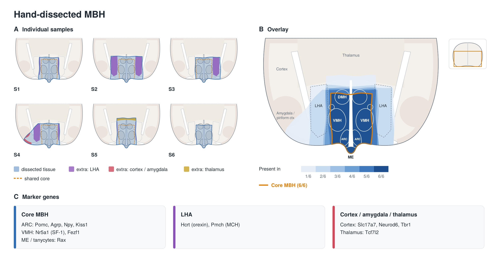

# LipoHypoLEP — anatomical QC of mediobasal hypothalamus samples

We are studying the effects of metreleptin on the brain using bulk RNA sequencing. Our hand dissections retain a shared central mediobasal hypothalamic (MBH) core, while the amount of surrounding tissue varies between samples.

## Correct comparisons going forward

The leptin-treatment comparison was reported in the reverse direction in two upstream analyses. The required direction is **LD_Leptin vs LD_Saline**. Use the following comparison definitions consistently in analysis outputs, figures and interpretation:

| # | Comparison | Numerator | Denominator | Required direction |
| --- | --- | --- | --- | --- |
| 1 | Baseline LD Phenotype | `LD_Saline` | `NonLD_Saline` | **LD_Saline / NonLD_Saline** |
| 2 | Leptin Rescue Effect | `LD_Leptin` | `LD_Saline` | **LD_Leptin / LD_Saline** |
| 3 | Residual Pathology after Leptin | `LD_Leptin` | `NonLD_Saline` | **LD_Leptin / NonLD_Saline** |

For every comparison, **positive log2 fold change means higher expression in the numerator**, and negative log2 fold change means higher expression in the denominator. Signed gene-level ranking statistics must follow that same direction; positive GSEA NES indicates enrichment toward the numerator end of the ranking.

Before reusing the two upstream analyses, verify their fitted contrasts and numerical signs. Correcting a reversed comparison requires consistently oriented effect estimates, signed statistics, rankings and enrichment results, not just new titles. The experimental results have not been reoriented in this branch. The repository's existing synthetic demonstration and input contract already specify LD LEPTIN vs LD SALINE for comparison 2; their control label is `NON-LD control`. Confirm that those control samples correspond to `NonLD_Saline` before importing experimental data under the existing labels.

“Leptin Rescue Effect” names the treatment comparison; evidence of rescue also requires relating the treatment change to the baseline LD phenotype. “Residual Pathology after Leptin” describes the post-treatment difference from controls, which can include both persistent LD-associated and treatment-induced changes.

## Shared MBH core, variable surrounding tissue

The anatomical interpretation of our dissections is that **the central MBH is retained in every sampled slice**, with variation mainly at the dissection edges. Some samples include more lateral hypothalamic area (LHA); others may include small amounts of cortex/amygdala or thalamic tissue. These differences in surrounding-tissue contributions can affect bulk expression even when the central MBH is consistently represented.

**Figure — Hand-dissected MBH: shared central core, variable edges.** (A) Six illustrative dissections show variation in the inclusion of LHA, cortex/amygdala and thalamus. (B) The overlay highlights the central MBH core retained across all six illustrated dissections, including the ARC, VMH, DMH and ME. The “6/6” annotation describes this schematic rather than a measured spatial-overlap analysis. (C) Regional marker genes provide anatomical context; they are not all treatment-independent QC markers. The seven-gene candidate panel below is evaluated separately for anatomical coverage and treatment sensitivity.

The anatomical QC panel therefore addresses two complementary questions: whether the intended central MBH compartments, including the median eminence (ME), are represented, and how much surrounding tissue contributes to each sample. Variable LHA or cortical signal should be interpreted alongside central MBH coverage rather than automatically treated as evidence that a sample missed the MBH.

This shared-core interpretation motivates the panel below. The HypoMap expression summaries help select markers; they do not themselves measure tissue overlap or establish complete anatomical capture in individual samples.

## Why we are revising the marker panel

Our previous approach may have introduced bias by stratifying samples using hypothalamic genes that respond to leptin. If these genes were also used for normalization or batch correction, part of the biological treatment response could have been treated as technical variation. Whether that happened still needs to be established from the upstream processing records.

An anatomical marker that changes with treatment can make an intact sample appear anatomically different. We therefore want a panel that covers ME vasculature, tanycytes and MBH neuronal populations, with particular attention to neuronal populations without detectable **Lepr** expression. The goal is to assess tissue coverage while preserving the metreleptin response we are trying to measure.

**Agrp** and **Pomc** remain useful context for ARC neuronal populations, but they are leptin-sensitive and their expression alone does not establish that the ME was retained.

## New candidate panel

The following expression summaries come from our **local analysis of HypoMap**. They describe enrichment in the reported atlas clusters or regions; they are not expression thresholds for bulk samples.

The original local-analysis exports are saved unchanged in this branch:

- [Panel summary](data/hypomap/panel_summary.csv)
- [Panel pseudobulk by region](data/hypomap/panel_pseudobulk_by_region.csv)

| Compartment | Gene | On-target CPM | Strongest reported off-target | Specificity from displayed CPM |
| --- | --- | --- | --- | --- |
| ME fenestrated endothelium | **Plvap** | 2678 (Plvap.Endothelial) | 63 (neural stem cells) | 42.5× |
| ME floor (β2 tanycytes) | **Scn7a** | 2907 (Scn7a tanycytes) | 162 (ependymal) | 17.9× |
| Tanycytes, all subtypes | **Col23a1** | 667–1283 across all five tanycyte clusters | 151 (meningeal fibroblasts) | 4.4–8.5× |
| Tanycytes, all subtypes | **Rax** | 150–456 across all five tanycyte clusters | 54 (one astrocyte cluster) | 2.8–8.4× |
| ARC neurons | **Crabp1** | 166 (ARC), 138 (posterior periventricular) | ≤11 in the other reported regions | ≥15.1× (ARC), ≥12.5× (posterior periventricular) |
| VMH + DMH neurons | **Gpr149** | 97 (VMH), 87 (DMH) | 32 (zona incerta) | 3.0× (VMH), 2.7× (DMH) |
| VMH neurons | **Fezf1** | 109 (VMH) | 30 (anterior hypothalamus/PVH) | 3.6× |

Ratios are calculated from the rounded CPM values shown. For Col23a1 and Rax, the ranges retain the variation across tanycyte clusters rather than reporting only the highest ratio. Specificity is relative to the reported comparison set, not established whole-brain exclusivity.

## What the panel tells us

**Plvap** provides a candidate readout of fenestrated endothelium associated with the ME. **Scn7a**, together with **Col23a1** and **Rax**, adds evidence for the tanycyte component. **Crabp1**, **Gpr149** and **Fezf1** extend coverage to ARC, VMH and DMH neuronal populations.

Together, these markers provide complementary evidence about dissection composition. Their combined presence would support representation of these compartments, but bulk expression cannot prove that the complete MBH was captured. Plvap is not intrinsically exclusive to ME vessels, and the neuronal candidates show expression outside their intended target regions. Anatomical interpretation should incorporate dissection records and spatial or histological evidence where available.

## How we will use it

Use this panel for descriptive anatomical QC, separate from normalization and batch correction. Review the compartments individually rather than allowing a strong signal in one compartment to compensate for missing evidence in another. Do not automatically exclude samples or adjust treatment effects using an unvalidated marker score.

The next validation step is to examine **Lepr coexpression in marker-positive cells**, spatial localization, and stability under leptin/metreleptin exposure. The supplied HypoMap summaries do not yet establish that these populations are Lepr-negative or that their markers are treatment-independent. Undetected Lepr can reflect limited single-cell sensitivity, and receptor-negative cells can still respond indirectly to treatment.

The panel is therefore our current anatomical-QC candidate set. Confirming its suitability requires retaining the HypoMap release, annotations and local analysis methods, checking the upstream use of the previous markers, and validating the new panel against the actual samples.
