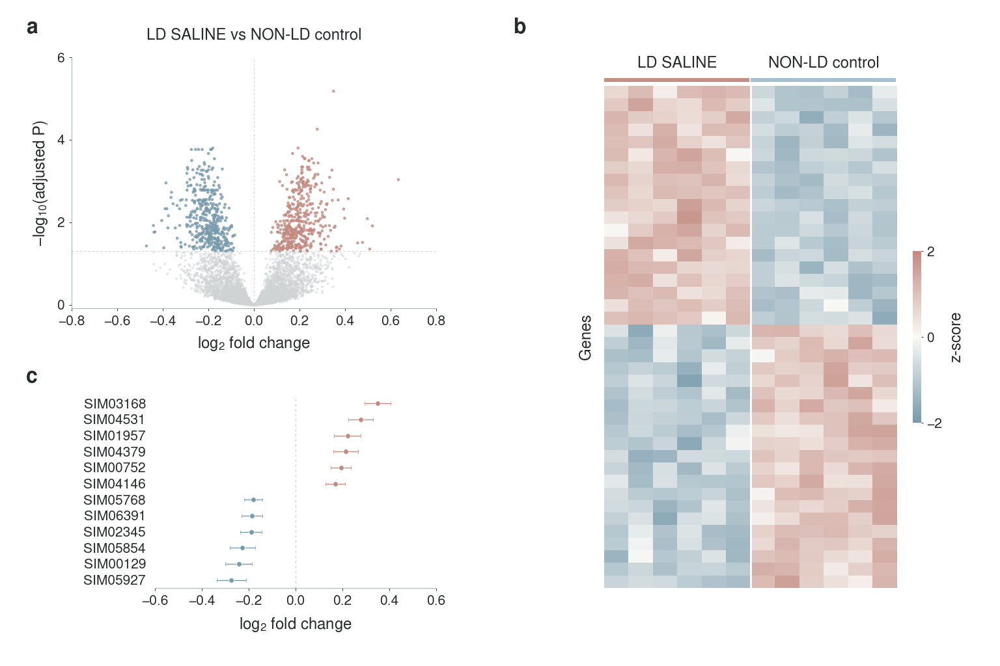
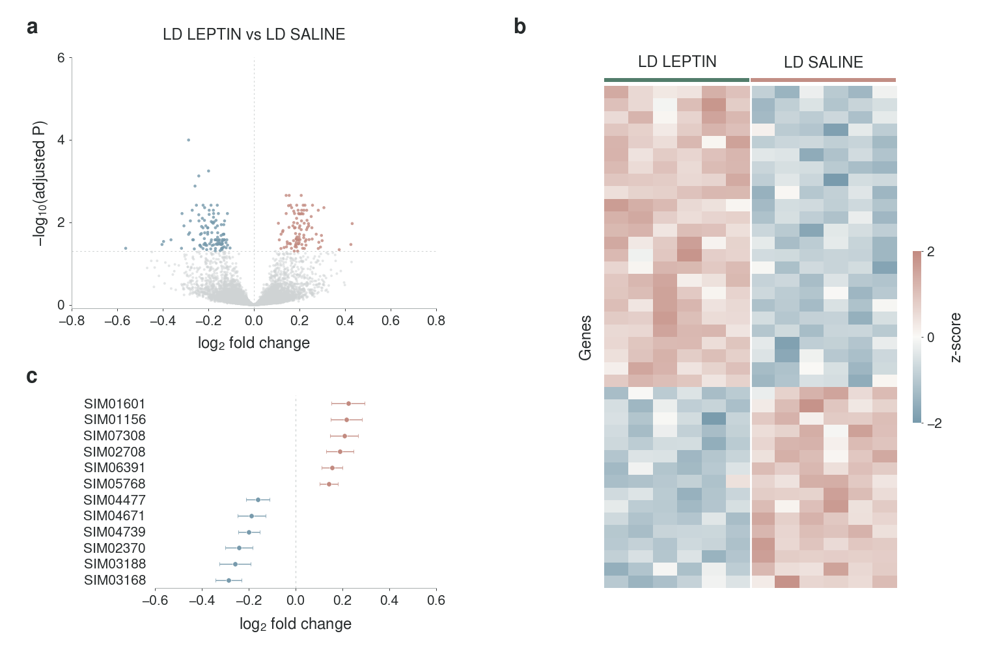
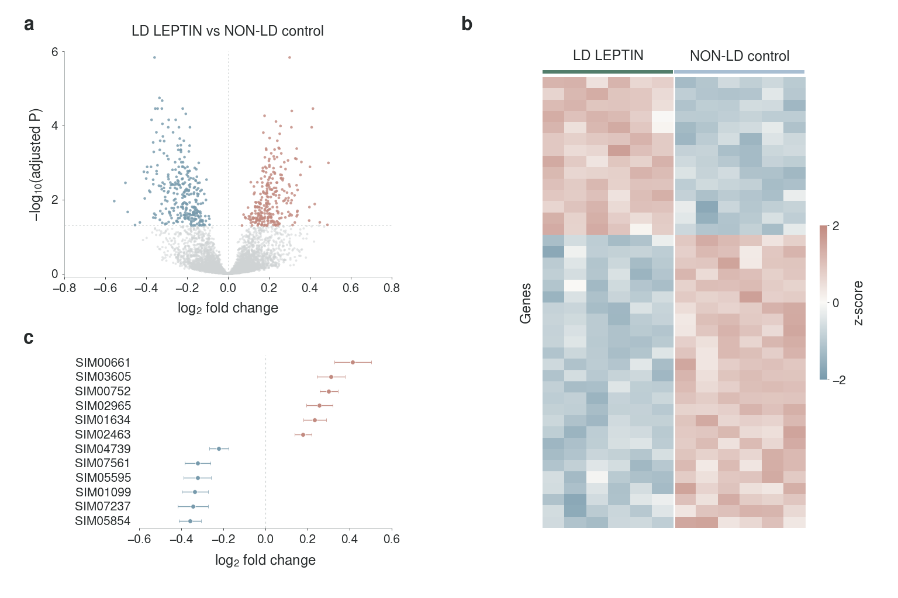

# LipoHypoLEP

Hypothalamic bulk RNA-seq figure development for **LD SALINE**, **LD LEPTIN**, and **NON-LD control** mice.

**Every figure below uses entirely synthetic data. These are layout and analysis demonstrations, not experimental evidence or predictions of this study's results.** All three figures, including Figure 1, have been rebuilt using an assumed small-effect, low-variance scenario with 8,000 anonymous genes and six mice per group. All 8,000 genes pass the example count filter. This scenario was chosen for visualization; it is not fitted to hypothalamic tissue, an estimate of expected experimental effects, or a power prediction.

The intended effect scale is around ±0.2 log2 fold change. This is not an axis boundary, significance cutoff, or universal standard: fitted estimates retain sampling variation and can exceed that scale. No real gene or pathway conclusions are implied.

## FIGURE 1 — How does untreated LD differ from non-LD controls?

**LD SALINE vs NON-LD control**



[Figure legend](figures/FIGURE_1_LEGEND.md) · [PNG](figures/figure_01_small_effects_synthetic.png) · [PDF](figures/figure_01_small_effects_synthetic.pdf) · [Outlined SVG](figures/figure_01_small_effects_synthetic.svg) · [Editable SVG](figures/figure_01_small_effects_synthetic_editable.svg) · [High-resolution PNG](figures/figure_01_small_effects_synthetic_300dpi.png)

## FIGURE 2 — What does leptin treatment change in LD mice?

**LD LEPTIN vs LD SALINE**



[Figure legend](figures/FIGURE_2_LEGEND.md) · [PNG](figures/figure_02_small_effects_synthetic.png) · [PDF](figures/figure_02_small_effects_synthetic.pdf) · [Outlined SVG](figures/figure_02_small_effects_synthetic.svg) · [Editable SVG](figures/figure_02_small_effects_synthetic_editable.svg) · [High-resolution PNG](figures/figure_02_small_effects_synthetic_300dpi.png)

## FIGURE 3 — What differences remain after leptin treatment?

**LD LEPTIN vs NON-LD control**



[Figure legend](figures/FIGURE_3_LEGEND.md) · [PNG](figures/figure_03_small_effects_synthetic.png) · [PDF](figures/figure_03_small_effects_synthetic.pdf) · [Outlined SVG](figures/figure_03_small_effects_synthetic.svg) · [Editable SVG](figures/figure_03_small_effects_synthetic_editable.svg) · [High-resolution PNG](figures/figure_03_small_effects_synthetic_300dpi.png)

This contrast describes differences present after treatment. They can include persistent LD-associated effects and treatment-induced effects; the comparison alone does not identify which differences were uncorrected. A nonsignificant post-treatment difference does not establish normalization.

## Figure files and methods

**[Complete figure pack, analysis source, and synthetic tables (ZIP)](figures/lipohypolep_synthetic_figure_pack.zip)**

Open a file on GitHub and use **Download raw file** to save it. The ZIP includes all three figures, every export, source scripts, synthetic tables, legends, dependency versions, and visual-reference notes.

Each figure has three panels: a volcano plot, a heatmap restricted to the two relevant groups, and selected gene effect estimates with 95% confidence intervals. PCA is omitted. Full group names replace letter codes. Questions, interpretation, methods, sample counts, thresholds, selection rules, and simulation disclosures appear in the separate legends and [shared methods](figures/FIGURE_LEGEND.md). File names and embedded artwork metadata also identify the synthetic demonstration.

## Visual references and typography

The design follows an inspection of author-archived Nature Biotechnology, Nature Methods, and Cell research figures, documented with source links and access limitations in the [visual reference review](figures/VISUAL_REFERENCE_REVIEW.md). There is no journal logo or assertion of publisher endorsement.

Every canvas is **1536 × 1024 pixels (3:2)**; the high-resolution PNGs are 4608 × 3072. All type is **Nimbus Sans**. PDFs contain embedded, searchable TrueType text; the primary SVGs outline lettering; editable SVGs include embedded font data. Font identities and plot selections are recorded in the [audit](figures/synthetic_demo/font_and_plot_audit.json).

The group-color lightness was adjusted after simulated color-vision-deficiency checks; full group names remain visible so identification does not depend on color alone. See the [color-accessibility review and simulation previews](figures/accessibility/COLOR_ACCESSIBILITY.md). These checks improve the design but do not guarantee accessibility for every viewer or reproduction condition.

## Reproduce

From the repository root:

```bash
python -m pip install -r figures/requirements.txt
python figures/synthetic_demo/simulate_and_analyze.py
python figures/synthetic_demo/render_figure.py
```

Install URW Nimbus Sans (Debian/Ubuntu package `fonts-urw-base35`), or set `NIMBUS_SANS_FONT_DIR` to its OTF font directory. Missing fonts cause a hard error instead of substitution.

The simulation uses seed **20261019**, negative-binomial counts, median-of-ratios normalization, and an **illustrative log-scale linear model**, with separate Benjamini–Hochberg correction for each contrast. Volcano colors use adjusted *P* < 0.05 alone, with no fold-change cutoff. The heatmap and effect-estimate panels rank all tested genes within each contrast without requiring significance. This is not DESeq2, edgeR, or limma-voom. See the [complete method](figures/FIGURE_LEGEND.md), [simulation source](figures/synthetic_demo/simulate_and_analyze.py), and [rendering source](figures/synthetic_demo/render_figure.py).

The [synthetic data directory](figures/synthetic_demo/data) contains count and expression matrices, metadata, three complete contrast tables, per-figure heatmap and forest-plot selections, separate simulation truth, and a [numerical summary](figures/synthetic_demo/data/simulation_summary.json). Positive log2 fold change means higher expression in the first named group.
