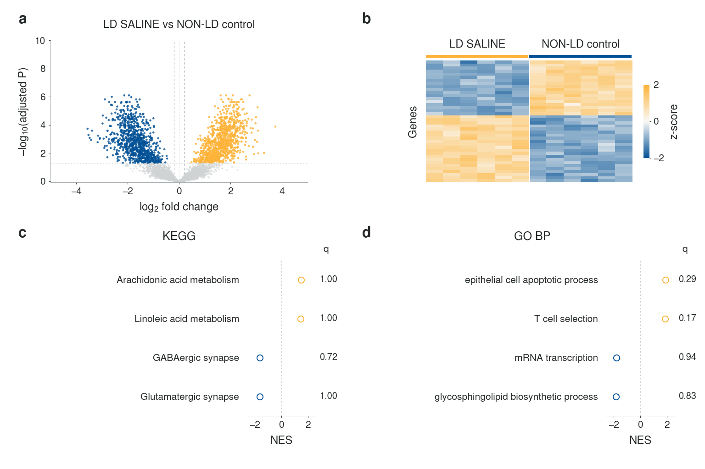
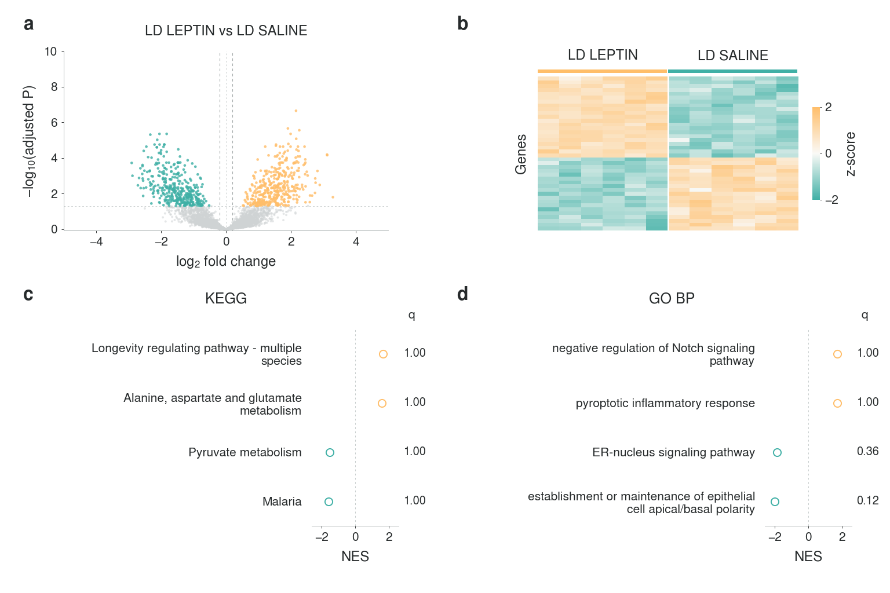
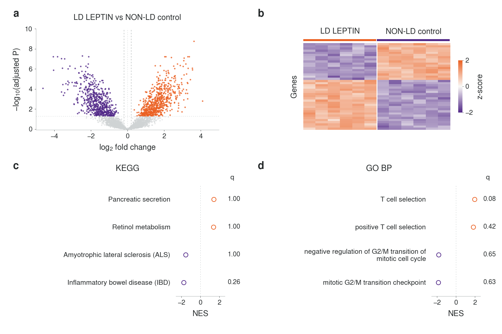

# LipoHypoLEP

Hypothalamic bulk RNA-seq figure development for **LD SALINE**, **LD LEPTIN**, and **NON-LD control** mice.

**Every figure below uses entirely synthetic data. These are layout and analysis demonstrations, not experimental evidence or predictions of this study's results.** The original synthetic simulation is retained: 8,000 anonymous genes and six mice per group, with 7,647 genes passing the example count filter. The figures demonstrate presentation and illustrative statistics; the simulation is not fitted to hypothalamic tissue and does not predict this study's effects, variability, or statistical power.

**Gene highlighting and heatmap selection require adjusted *P* < 0.05 and absolute log2 fold change ≥ 0.2.** The ±0.2 values are effect-size cutoffs; fitted estimates are unchanged and are not clipped at those values. KEGG and GO Biological Process GSEA use all 7,647 retained genes ranked by the signed test statistic, without either DEG filter. Real mouse pathway memberships and an actual enrichment calculation are used, but gene identities are assigned randomly to the synthetic statistics: no tissue-derived gene or pathway findings are implied.

## FIGURE 1 — How does untreated LD differ from non-LD controls?

**LD SALINE vs NON-LD control**



[Figure legend](figures/FIGURE_1_LEGEND.md) · [PNG](figures/figure_01_gsea_synthetic.png) · [PDF](figures/figure_01_gsea_synthetic.pdf) · [Outlined SVG](figures/figure_01_gsea_synthetic.svg) · [Editable SVG](figures/figure_01_gsea_synthetic_editable.svg) · [High-resolution PNG](figures/figure_01_gsea_synthetic_300dpi.png)

## FIGURE 2 — What does leptin treatment change in LD mice?

**LD LEPTIN vs LD SALINE**



[Figure legend](figures/FIGURE_2_LEGEND.md) · [PNG](figures/figure_02_gsea_synthetic.png) · [PDF](figures/figure_02_gsea_synthetic.pdf) · [Outlined SVG](figures/figure_02_gsea_synthetic.svg) · [Editable SVG](figures/figure_02_gsea_synthetic_editable.svg) · [High-resolution PNG](figures/figure_02_gsea_synthetic_300dpi.png)

## FIGURE 3 — What differences remain after leptin treatment?

**LD LEPTIN vs NON-LD control**



[Figure legend](figures/FIGURE_3_LEGEND.md) · [PNG](figures/figure_03_gsea_synthetic.png) · [PDF](figures/figure_03_gsea_synthetic.pdf) · [Outlined SVG](figures/figure_03_gsea_synthetic.svg) · [Editable SVG](figures/figure_03_gsea_synthetic_editable.svg) · [High-resolution PNG](figures/figure_03_gsea_synthetic_300dpi.png)

This contrast describes differences present after treatment. They can include persistent LD-associated effects and treatment-induced effects; the comparison alone does not identify which differences were uncorrected. A nonsignificant post-treatment difference does not establish normalization.

## Figure files and methods

**[Complete figure pack, analysis source, and synthetic tables (ZIP)](figures/lipohypolep_synthetic_figure_pack.zip)**

Open a file on GitHub and use **Download raw file** to save it. The ZIP includes all three figures, every export, source scripts, synthetic tables, legends, dependency versions, and visual-reference notes.

Each figure has four panels: a volcano plot, a heatmap restricted to the two relevant groups, KEGG preranked GSEA, and GO Biological Process preranked GSEA. PCA is omitted. Full group names replace letter codes. Questions, interpretation, methods, sample counts, thresholds, selection rules, and simulation disclosures appear in the separate legends and [shared methods](figures/FIGURE_LEGEND.md). File names and embedded artwork metadata also identify the synthetic demonstration.

## Visual references and typography

The design follows an inspection of author-archived Nature Biotechnology, Nature Methods, and Cell research figures, documented with source links and access limitations in the [visual reference review](figures/VISUAL_REFERENCE_REVIEW.md). There is no journal logo or assertion of publisher endorsement.

Every canvas is **1536 × 1024 pixels (3:2)**; the high-resolution PNGs are 4608 × 3072. All type is **Nimbus Sans**. PDFs contain embedded, searchable TrueType text; the primary SVGs outline lettering; editable SVGs include embedded font data. The [font verification](figures/FONT_VERIFICATION.md) checks actual exported Nimbus Sans font programs, metrics, and glyph outlines against the source fonts; its [report](figures/synthetic_demo/export_font_verification.json) identifies checked files by SHA-256. Plot selections and labels are recorded in the [plot audit](figures/synthetic_demo/font_and_plot_audit.json).

Each comparison uses its own warm/cool pair from the supplied color-scheme guide: Figure 1 yellow/blue, Figure 2 tan/turquoise, and Figure 3 orange/purple. Colors encode direction within a comparison; group colors are not fixed across figures. Full group names, effect direction on the axes, and marker fill provide additional encodings. See the [color-accessibility review and simulation previews](figures/accessibility/COLOR_ACCESSIBILITY.md).

## Reproduce

From the repository root:

```bash
python -m pip install -r figures/requirements.txt
python figures/synthetic_demo/simulate_and_analyze.py
python figures/synthetic_demo/run_gsea.py \
  --kegg-gmt figures/synthetic_demo/gsea_data/resources/kegg_mouse_biosystems_archive_2020.gmt \
  --go-bp-gmt figures/synthetic_demo/gsea_data/resources/go_bp_mouse_2026_05_19_nonIEA_protein_coding.gmt \
  --kegg-provenance figures/synthetic_demo/gsea_data/resources/kegg_mouse_provenance.json \
  --go-bp-provenance figures/synthetic_demo/gsea_data/resources/go_bp_mouse_provenance.json
python figures/synthetic_demo/render_figure.py
python figures/synthetic_demo/verify_export_fonts.py
```

Install URW Nimbus Sans (Debian/Ubuntu package `fonts-urw-base35`), or set `NIMBUS_SANS_FONT_DIR` to its OTF font directory. Missing fonts cause a hard error instead of substitution.

The simulation uses seed **20261019**, negative-binomial counts, median-of-ratios normalization, and an **illustrative log-scale linear model**, with separate Benjamini–Hochberg correction for each contrast. Volcano highlights and heatmap selection use the joint adjusted-*P* and absolute-log2-fold-change cutoffs. GSEA ranks the full tested-gene universe; its empirical FDR q values are distinct from gene-level Benjamini–Hochberg adjusted *P* values. **These scripts generate and analyze this simulation only; they are not an implemented or tested reader/analysis pipeline for experimental data.** The log2(normalized count + 0.5) model can compress low-expression effects and is unsuitable for production effect estimation. Future experimental inputs should supply validated count-model estimates and signed ranking statistics, for example from an appropriate DESeq2 or edgeR workflow. See the [complete method](figures/FIGURE_LEGEND.md), [simulation source](figures/synthetic_demo/simulate_and_analyze.py), and [rendering source](figures/synthetic_demo/render_figure.py).

The [synthetic data directory](figures/synthetic_demo/data) contains count and expression matrices, metadata, three complete contrast tables, selected genes, supporting gene-effect intervals, separate simulation truth, and a [numerical summary](figures/synthetic_demo/data/simulation_summary.json). The [GSEA directory](figures/synthetic_demo/gsea_data) contains the complete rankings, random gene-symbol assignment, all enrichment results, leading-edge members, and [run provenance](figures/synthetic_demo/gsea_data/gsea_provenance.json). Annotation versions and limitations are recorded for [KEGG](figures/synthetic_demo/gsea_data/resources/kegg_mouse_provenance.json) and [GO BP](figures/synthetic_demo/gsea_data/resources/go_bp_mouse_provenance.json). Positive log2 fold change and positive normalized enrichment score refer to the first named group.
