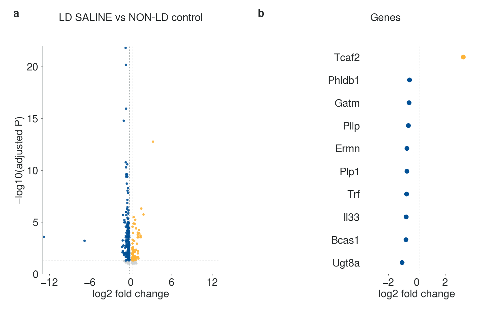
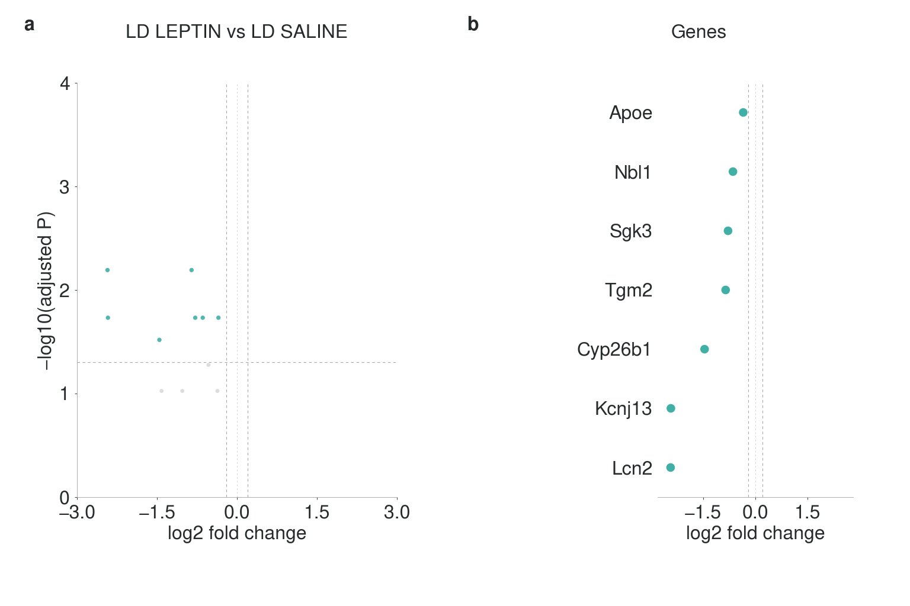
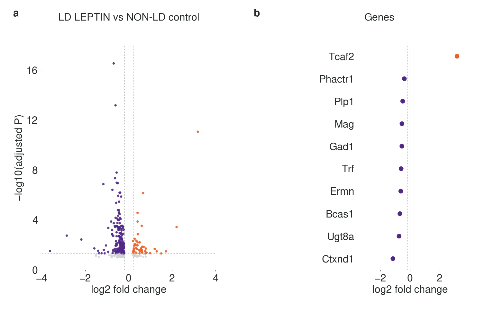

# LipoHypoLEP — male data, 30 September 2026

Latest supplied male hypothalamic DE results for **LD SALINE**, **LD LEPTIN** and **NON-LD control**, on branch **`analysis/male-2026-09-30`**.

**[Findings and analysis scope](docs/MALE_2026_09_30_ANALYSIS.md) · [Figure legends](figures/male_2026_09_30/FIGURE_LEGENDS.md) · [Original CSVs](data/male_2026_09_30/source) · [Complete analysis outputs](analysis/male_2026_09_30_results)**

The user confirmed these are **filtered lists**, with source effects defined as first group minus second in each filename. Supplied estimates and probabilities are preserved; the treatment contrast is reversed to show LD LEPTIN minus LD SALINE. Gene highlighting uses **adjusted P < 0.05 and |log2 fold change| ≥ 0.2**.

**KEGG/GO BP GSEA awaits complete tested-gene tables**, including nonsignificant genes and a signed statistic. **Individual expression values are also missing**, so sample heatmaps are pending. The current figures contain two supported panels: a volcano of the supplied rows and selected gene-effect points. Older enrichment findings are not reused for these data.

| Figure | Comparison | Supplied genes | Joint-cutoff hits | Higher | Lower |
|---|---|---:|---:|---:|---:|
| 1 | LD SALINE vs NON-LD control | 456 | 341 | 84 | 257 |
| 2 | LD LEPTIN vs LD SALINE | 11 | 7 | 0 | 7 |
| 3 | LD LEPTIN vs NON-LD control | 297 | 220 | 43 | 177 |

Counts refer to the supplied filtered exports. Absence from an export does not establish nonsignificance, zero effect or treatment rescue. The [134 shared joint-cutoff hits](analysis/male_2026_09_30_results/baseline_posttreatment_shared_hits.tsv) in the two LD-versus-control comparisons all have the same direction (11 higher, 123 lower).

## FIGURE 1 — How does untreated LD differ from non-LD controls?

**LD SALINE vs NON-LD control**



[Legend](figures/male_2026_09_30/FIGURE_LEGENDS.md#figure-1) · [PNG](figures/male_2026_09_30/figure_01_male_2026_09_30.png) · [PDF](figures/male_2026_09_30/figure_01_male_2026_09_30.pdf) · [Outlined SVG](figures/male_2026_09_30/figure_01_male_2026_09_30.svg) · [Editable SVG](figures/male_2026_09_30/figure_01_male_2026_09_30_editable.svg) · [300 dpi PNG](figures/male_2026_09_30/figure_01_male_2026_09_30_300dpi.png) · [Joint-cutoff genes](analysis/male_2026_09_30_results/figure_01_joint_hits.tsv)

## FIGURE 2 — What does leptin treatment change in LD mice?

**LD LEPTIN vs LD SALINE**



[Legend](figures/male_2026_09_30/FIGURE_LEGENDS.md#figure-2) · [PNG](figures/male_2026_09_30/figure_02_male_2026_09_30.png) · [PDF](figures/male_2026_09_30/figure_02_male_2026_09_30.pdf) · [Outlined SVG](figures/male_2026_09_30/figure_02_male_2026_09_30.svg) · [Editable SVG](figures/male_2026_09_30/figure_02_male_2026_09_30_editable.svg) · [300 dpi PNG](figures/male_2026_09_30/figure_02_male_2026_09_30_300dpi.png) · [Joint-cutoff genes](analysis/male_2026_09_30_results/figure_02_joint_hits.tsv)

All seven joint-cutoff treatment hits are lower in LD LEPTIN: **Lcn2, Tgm2, Apoe, Sgk3, Nbl1, Kcnj13 and Cyp26b1**. The source saline-minus-leptin effects are negated; P values are unchanged.

## FIGURE 3 — What differences remain after leptin treatment?

**LD LEPTIN vs NON-LD control**



[Legend](figures/male_2026_09_30/FIGURE_LEGENDS.md#figure-3) · [PNG](figures/male_2026_09_30/figure_03_male_2026_09_30.png) · [PDF](figures/male_2026_09_30/figure_03_male_2026_09_30.pdf) · [Outlined SVG](figures/male_2026_09_30/figure_03_male_2026_09_30.svg) · [Editable SVG](figures/male_2026_09_30/figure_03_male_2026_09_30_editable.svg) · [300 dpi PNG](figures/male_2026_09_30/figure_03_male_2026_09_30_300dpi.png) · [Joint-cutoff genes](analysis/male_2026_09_30_results/figure_03_joint_hits.tsv)

## Artwork and reproducibility

All text is **32 px Nimbus Sans**, including axes, ticks, gene names, comparison labels and panel letters. Canvas size is **1536 × 1024**, with **4608 × 3072** high-resolution PNGs. Figure 1 uses yellow/blue, Figure 2 tan/turquoise and Figure 3 orange/purple. The complete effect range is retained on explicit per-contrast axes; estimates are unchanged. Every actual PDF span, embedded font glyph/metric program and PNG/PDF content match is checked in the [export verification](figures/male_2026_09_30/figure_validation.json). The [palette accessibility review](figures/accessibility/COLOR_ACCESSIBILITY.md) documents the shared colors using the original template artwork.

From the repository root, with Python 3.12 and URW Nimbus Sans installed:

```bash
python -m pip install -r analysis/requirements.txt
python analysis/analyze_male_2026_09_30.py
python analysis/render_male_2026_09_30.py
python analysis/render_male_2026_09_30.py --check-report
python -m unittest tests.test_male_2026_09_30 -v
```

Set `NIMBUS_SANS_FONT_DIR` to the URW OTF directory if needed. Missing fonts cause an error. Analysis and figure manifests bind exact source bytes, code and outputs with SHA-256. No count normalization, DE refit, effect scaling, new BH correction or sample-expression reconstruction is performed.

## Project records and earlier analyses

The [mouse register](docs/PROJECT_MICE.md) contains 30 project animals, including four males per group. These CSVs do not identify individual libraries or mice; sequencing sample counts remain unassigned.

The [historical workbook gallery](docs/LEGACY_GALLERY.md) and [its published branch](https://github.com/Jaislab/LipoHypoLEP/tree/analysis/legacy-anke-data) preserve the earlier experimental analysis. The [synthetic template](docs/SYNTHETIC_SCAFFOLD.md) remains on [`main`](https://github.com/Jaislab/LipoHypoLEP/tree/main). Earlier results are separate from the male exports dated 30 September 2026.
