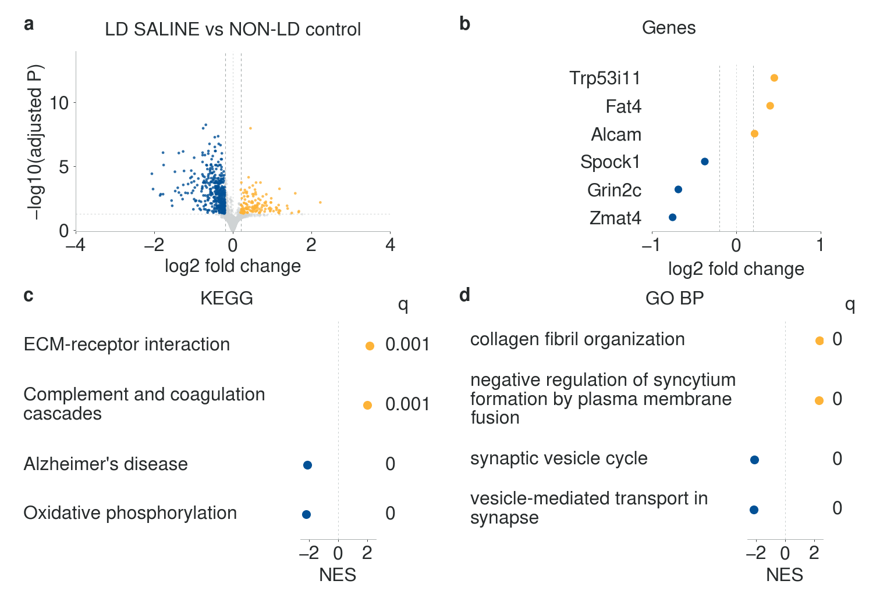
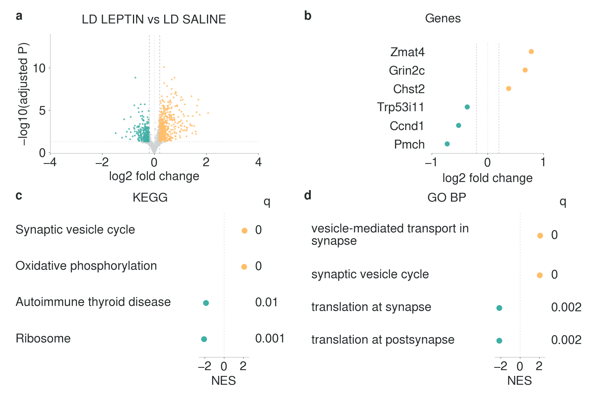
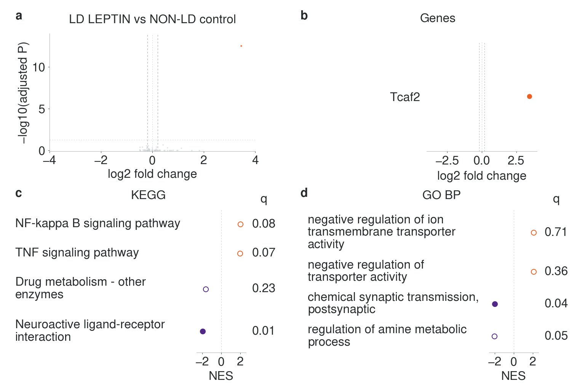

# LipoHypoLEP — historical experimental results

Hypothalamic bulk RNA-seq in **LD SALINE**, **LD LEPTIN**, and **NON-LD control** mice.

**[Project mouse register](docs/PROJECT_MICE.md): 30 mice — 18 females and 12 males.** Each group contains six females and four males. [Individual IDs, sex and recorded genotypes](data/project/mice.csv) are retained separately from sequencing sample identifiers.

This branch, **`analysis/legacy-anke-data`**, contains an exploratory analysis of the three complete differential-expression tables in `DGElist_AnkeData(1).xlsx`. **[The original synthetic template remains on `main`](https://github.com/Jaislab/LipoHypoLEP/tree/main).** Its files are unchanged here, with its gallery and reproduction instructions preserved in [Synthetic figure scaffolding](docs/SYNTHETIC_SCAFFOLD.md).

**[Initial findings and ranking sensitivity](docs/LEGACY_RESULTS.md) · [Analysis methods](docs/LEGACY_ANALYSIS.md) · [Figure legends](figures/legacy/FIGURE_LEGENDS.md)**

The supplied estimates and P values are preserved. Gene highlighting requires **adjusted P < 0.05 and |log2 fold change| ≥ 0.2**; effects are neither rescaled nor clipped. The workbook has no individual sample expression, so panel b shows selected gene-effect estimates rather than a heatmap. KEGG and GO BP GSEA use every tested gene, with an explicitly derived signed-P ranking because the original test statistic is absent.

| Figure | Comparison | Tested genes | Higher / lower at both cutoffs |
|---|---|---:|---:|
| 1 | LD SALINE vs NON-LD control | 15,518 | 142 / 432 |
| 2 | LD LEPTIN vs LD SALINE | 15,136 | 512 / 238 |
| 3 | LD LEPTIN vs NON-LD control | 19,721 | 1 / 0 |

**Interpret Figure 3 cautiously:** its supplied effects are unusually compressed near zero, and effect/SE ratios do not reproduce the source P values. These observations require clarification of the upstream estimation and shrinkage methods. They do not establish normalization after leptin. See the [analysis scope and methods](docs/LEGACY_ANALYSIS.md).

## FIGURE 1 — How does untreated LD differ from non-LD controls?

**LD SALINE vs NON-LD control**



[Legend](figures/legacy/FIGURE_LEGENDS.md#figure-1) · [PNG](figures/legacy/figure_01_legacy.png) · [PDF](figures/legacy/figure_01_legacy.pdf) · [Outlined SVG](figures/legacy/figure_01_legacy.svg) · [Editable SVG](figures/legacy/figure_01_legacy_editable.svg) · [300 dpi PNG](figures/legacy/figure_01_legacy_300dpi.png) · [Complete DE table](analysis/legacy_results/figure_01_deg.tsv.gz)

## FIGURE 2 — What does leptin treatment change in LD mice?

**LD LEPTIN vs LD SALINE**



[Legend](figures/legacy/FIGURE_LEGENDS.md#figure-2) · [PNG](figures/legacy/figure_02_legacy.png) · [PDF](figures/legacy/figure_02_legacy.pdf) · [Outlined SVG](figures/legacy/figure_02_legacy.svg) · [Editable SVG](figures/legacy/figure_02_legacy_editable.svg) · [300 dpi PNG](figures/legacy/figure_02_legacy_300dpi.png) · [Complete DE table](analysis/legacy_results/figure_02_deg.tsv.gz)

The source tab is `saline_VS_leptin`: its fold-change signs are reversed for this treatment-minus-saline presentation. Original source effects remain in a separate column; probabilities and SEs are unchanged.

## FIGURE 3 — What differences remain after leptin treatment?

**LD LEPTIN vs NON-LD control**



[Legend](figures/legacy/FIGURE_LEGENDS.md#figure-3) · [PNG](figures/legacy/figure_03_legacy.png) · [PDF](figures/legacy/figure_03_legacy.pdf) · [Outlined SVG](figures/legacy/figure_03_legacy.svg) · [Editable SVG](figures/legacy/figure_03_legacy_editable.svg) · [300 dpi PNG](figures/legacy/figure_03_legacy_300dpi.png) · [Complete DE table](analysis/legacy_results/figure_03_deg.tsv.gz)

This contrast can contain both persistent LD-associated and treatment-induced differences. Only **Tcaf2** passes both gene-display cutoffs; nonsignificance of other genes is not evidence of equivalence.

## Analysis and artwork

Each figure contains **a**, volcano; **b**, selected gene-effect points; **c**, KEGG preranked GSEA; **d**, GO Biological Process preranked GSEA. Methods and interpretation appear in the separate [legends](figures/legacy/FIGURE_LEGENDS.md). There are no inferred samples, confidence intervals or PCA panels.

All text is **32 px Nimbus Sans**, including GSEA terms, q values, axes, ticks and panel letters. Every canvas is **1536 × 1024**; high-resolution PNGs are **4608 × 3072**. PDF embeds the actual Nimbus font programs, primary SVG outlines the lettering, and editable SVG includes the fonts. [Independent export verification](figures/legacy/legacy_validation.json) checks the font programs, glyph outlines and text sizes. At 180 mm printed width, type is approximately 10.6 pt.

Figure 1 uses yellow/blue, Figure 2 tan/turquoise, and Figure 3 orange/purple, following the supplied color guide. Direction and significance also use axis position and marker fill. The [palette accessibility review](figures/accessibility/COLOR_ACCESSIBILITY.md) documents these colors; its simulation images show the original synthetic artwork, not this workbook analysis.

The [complete primary GSEA results](analysis/legacy_results/gsea), [signed-Z weighting sensitivity](analysis/legacy_results/gsea/signed_z), [import provenance](analysis/legacy_results/legacy_provenance.json), and [plot audit](figures/legacy/legacy_plot_audit.json) retain full rankings, tested pathways, leading-edge genes, selections and checksums. Gene-level BH adjusted P values and empirical GSEA FDR q values are different quantities. Neither DEG cutoff is used to filter GSEA.

Enrichment remains exploratory: the original signed test statistic is missing, contrast-specific tested universes differ, KEGG is an archived 2020 collection, and exact symbol mapping leaves documented ambiguous-symbol and mitochondrial GO coverage gaps. The [methods](docs/LEGACY_ANALYSIS.md) describe these limits and the sensitivity analysis. No synthetic identifier assignment is used for these experimental results.

## Reproduce this branch

Install Python 3.12 and URW Nimbus Sans (`fonts-urw-base35` on Debian/Ubuntu). Alternatively set `NIMBUS_SANS_FONT_DIR` to its OTF directory. Missing fonts cause an error rather than font substitution.

```bash
python -m pip install -r analysis/requirements.txt
python analysis/legacy_workbook.py \
  --workbook /path/to/DGElist_AnkeData.xlsx \
  --complete-tested-universe
python analysis/legacy_gsea.py --rank-metric both
python analysis/audit_legacy_gsea.py
python analysis/render_legacy_figures.py
python analysis/verify_legacy_outputs.py
python -m unittest discover -s tests -p 'test_legacy*.py' -v
```

The workbook path may have any filename; its bytes must match the recorded SHA-256 to reproduce this import. The original spreadsheet remains a local input; the branch contains curated derived tables. To regenerate enrichment and figures from the committed tables, omit the importer command. `python analysis/verify_legacy_outputs.py --check-report` checks that the saved verification still matches the current code, inputs and artwork.

The future handoff with per-sample FPKMs remains covered by the [experimental CSV contract](docs/INPUT_DATA_CONTRACT.md) and [original code audit](docs/CODE_AUDIT.md). Those documents describe the original scaffold and expected future inputs, rather than a refitted analysis of this legacy workbook.
